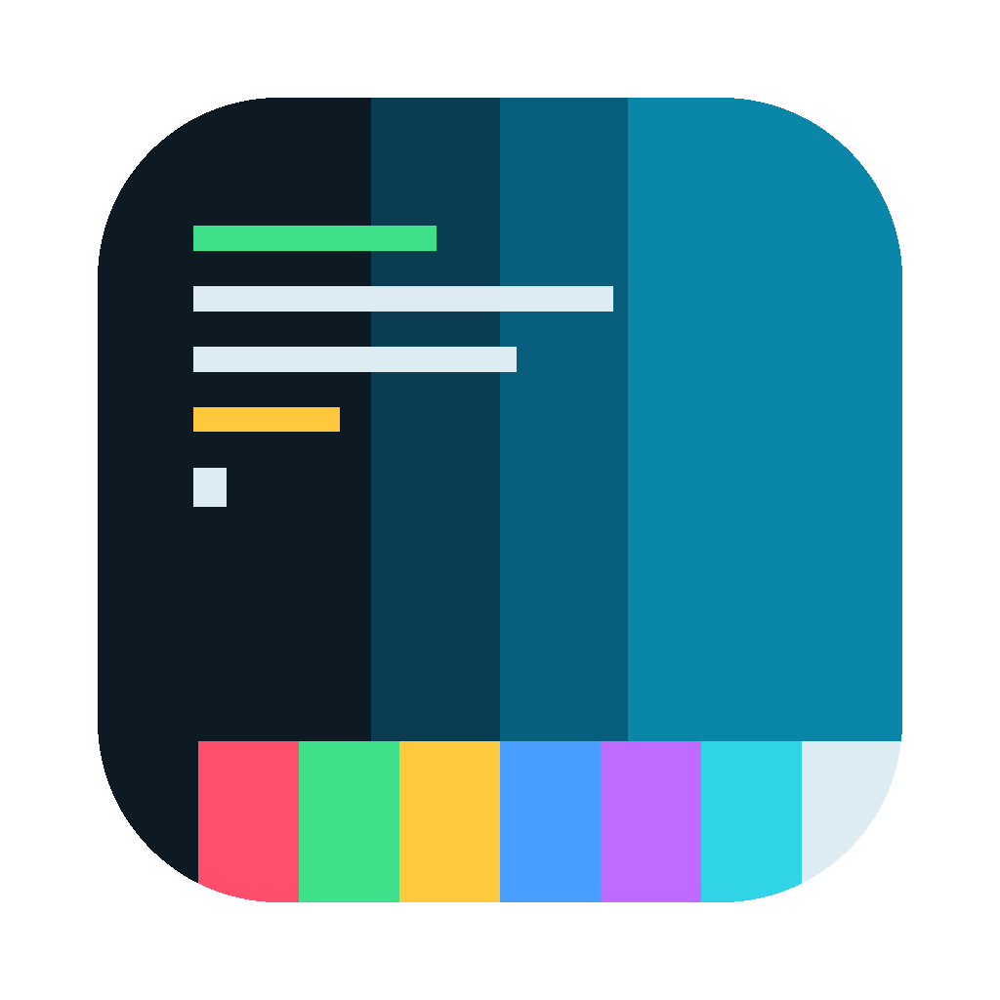

# pywal (murtaza64 fork) and WalStudio

A fork of [pywal16](https://github.com/eylles/pywal16) that keeps generated colours on their ANSI meaning (colour 1 reads as red, 2 as green, …), adds tunable OKLCH palettes, a semantic palette for documents and apps (`palette.json`), and **Palette Studio / WalStudio**: a local UI to tune a palette on a mock desktop and apply it to chosen apps with Undo.

- What changed from pywal16 (CLI, generation, templates): [docs/FORK.md](docs/FORK.md)
- Palette Studio and the WalStudio app: [docs/walstudio.md](docs/walstudio.md)
- The semantic palette contract: [docs/wal-palette.md](docs/wal-palette.md)

## Install

    git clone https://github.com/murtaza64/pywal && cd pywal
    uv run -m pywal -i ~/Pictures/wallpaper.jpg   # generate and apply, as `wal` does
    uv run -m pywal.studio                      # Palette Studio at http://127.0.0.1:4790/

Needs Python 3.13+ ([uv](https://docs.astral.sh/uv/) installs it) and ImageMagick (`magick`). macOS is where this fork is used and tested; the CLI keeps pywal's Linux support but it is not tested here.

## Licence and upstream

MIT, see [LICENSE.md](LICENSE.md). Based on pywal by Dylan Araps and pywal16 by eylles and contributors. Everything in the upstream documentation below still applies except where [docs/FORK.md](docs/FORK.md) says otherwise (notably: one colour backend, fewer bundled templates).

---

The original pywal README follows.

Pywal is a tool that generates a color palette from the dominant colors in an image. It then applies the colors system-wide and on-the-fly in all of your favourite programs.  

There are currently 8 supported color generation backends, each providing a different palette of colors from each image. You're bound to find an appealing color-scheme.

Pywal also supports predefined themes and has over 250 themes built-in. You can also create your own theme files to share with others.

The goal of Pywal was to be as out of the way as possible. It doesn't modify any of your existing configuration files. Instead it works around them and provides tools to integrate your system as you see fit.

Terminal emulators and TTYs have their color-schemes updated in real-time with no delay. With minimal configuration this functionality can be extended to almost anything running on your system.

### More: \[[Installation](https://github.com/eylles/pywal16/wiki/Installation)] \[[Getting Started](https://github.com/eylles/pywal16/wiki/Getting-Started)] \[[Customization](https://github.com/eylles/pywal16/wiki/Customization)] \[[Wiki](https://github.com/eylles/pywal16/wiki)] \[[Screenshots](https://www.reddit.com/r/unixporn/search?q=wal&restrict_sr=on&sort=relevance&t=all)] \[[Extras](https://github.com/eylles/pywal-extra)]

