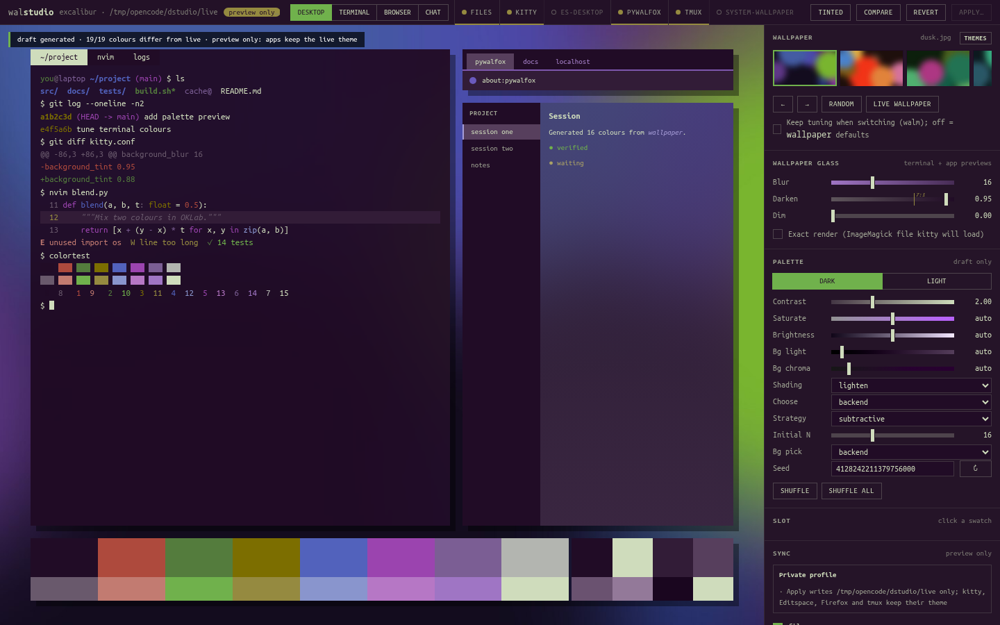
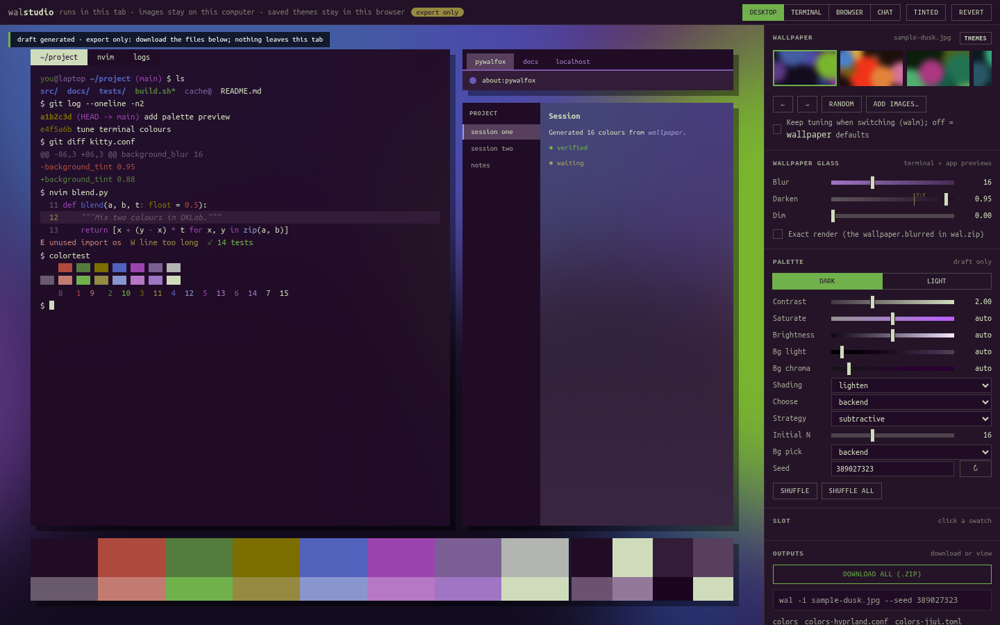

# Palette Studio and WalStudio

Palette Studio is a local web UI for this fork: pick a wallpaper, tune the palette, preview it on a mock desktop (terminal, browser, app), then Apply it to the apps you choose, with a backup for Undo. WalStudio is the same UI as a macOS app.

## Run

    uv run -m pywal.studio                    # http://127.0.0.1:4790/, preview only
    uv run -m pywal.studio --allow-apply      # enable Apply

| Option | Default | Meaning |
|---|---|---|
| `--wallpapers DIR` | `~/wallpapers` | images offered in the strip |
| `--live-dir DIR` | `~/.cache/wal` | the theme files Apply writes (what apps read) |
| `--targets a,b` | all | sync targets this instance may plan or apply; others are refused by the server |
| `--backups DIR` | `~/.cache/pywal-studio/backups` | before-Apply copies (Undo) and applied history |
| `--scratch DIR` | temp | previews and thumbnails; never the live directory |
| `--host`, `--port` | `127.0.0.1`, `4790` | keep loopback: wallpapers and palettes stay private |

Needs Python 3.13+, `uv`, and ImageMagick (`magick`) on `PATH` for the blurred wallpaper and thumbnails. Palette generation needs only Python (Pillow and `modern_colorthief`).

## Use

- **Wallpaper strip**: click to generate; ←/→, Random, Live wallpaper (jump to the live theme's image). A coloured band under a thumbnail means the cache already holds a scheme for it.
- **Themes**: built-in and saved themes, and cached schemes, each with an 8-colour band; Save stores the draft as a theme.
- **Scenes**: Desktop (terminal, browser and chat on the wallpaper), or one of them filling the stage.
- **manaDJ scene**: the draft as manaDJ's wallpaper theme, mapped by the module manaDJ's wallpaper theme uses on `palette.json` (gh#470) (`static/manadj.js`, generated from manaDJ's `walTheme.ts`). Four waveform rows, four decks and the track list. Toggles: wallpaper or identity deck colours; waveform preset (RGB default, Triad, Deck, Accent); the blurred track-list backdrop, dimmed to keep text at 7:1 over this wallpaper's brightest blurred region. Waveforms use manaDJ's additive-RGB formula on synthetic audio. Light palettes show why manaDJ keeps its default theme (it is dark-only).
- **Palette**: dark/light, contrast, saturation, brightness, background lightness/chroma, shading, choose, strategy, seed, shuffle. Every change updates the draft only; the stage says when it is updating, the result, or why a preview failed.
- **Slot**: click a swatch to pin a colour (hex or OKLCH sliders).
- **Wallpaper glass**: Blur, Darken (terminal background tint toward the palette background; a 7:1 readability floor is marked), Dim (darken the wallpaper itself). Previewed on the terminal and app mocks.
- **Compare**: split the stage against the live theme; hold C to flash it.
- **Sync**: a mode line says where Apply writes (live theme or a private profile). Plan shows every write and command; Apply asks for confirmation, then reports each target.
- **Applied**: every Apply with its palette, targets and per-target result, per wallpaper; Load (as draft), Compare, Restore (through Plan/Apply). History starts with this version.
- **Before-Apply backups**: the live files as they were before each Apply; load one and Apply it to undo.

## Sync targets

| Target | What Apply does | Proof shown | Tested |
|---|---|---|---|
| files | backs up, then writes `colors.json`, `palette.json/css` and every template into the live directory | re-reads `colors.json` | macOS |
| kitty | `kitty @ set-colors` + blurred (and dimmed) wallpaper as background image, every instance | `kitty @ get-colors` | macOS, kitty 0.47 |
| pywalfox | `pywalfox update` | none (no readback): `sent` | macOS |
| tmux | re-sources `~/.config/tmux/tmux.conf` or `~/.tmux.conf` | exit status | macOS |
| Editspace (optional) | nothing; the app follows `colors.json` | its appearance receipt: `loaded`, or `verified` when an open window confirms it | macOS |
| system wallpaper | pywal's wallpaper change | none; off by default | not tested |

Absent apps are shown as unavailable with the reason and are skipped. kitty needs remote control: `allow_remote_control socket-only` and `listen_on unix:/tmp/kitty-{kitty_pid}.sock` in `kitty.conf`, and `background_image ~/.cache/wal/wallpaper.blurred` to show the glass. Other apps that read pywal's templates (nvim, delta, jjui, opencode, waybar, …) pick up the new files on their next reload; Studio does not reload them.

Not supported: detecting or theming arbitrary installed apps; Apply on Linux/Windows is untested.

## WalStudio (macOS app)

    desktop/walstudio/bundle.sh       # builds desktop/walstudio/dist/WalStudio.app (unsigned)

The app runs its own Studio backend on a free loopback port and stops it on quit. File > Choose Wallpapers… picks a folder or an image on your Mac. By default Apply writes a private profile inside the app (your apps keep their theme); the Sync mode line switches to the live theme (`~/.cache/wal`) after a confirmation. Settings: `~/Library/Application Support/WalStudio/config.json` (`pywal`, `wallpapers`, `liveDir`, `targets`). The app is unsigned: right-click > Open the first time.

From a release: clone this fork to `~/pywal` (or set `pywal` in the config), unzip `WalStudio.app` from the release, then right-click > Open. It needs `uv` and ImageMagick as above.

## In the browser

The same Studio page, running in a browser tab with nothing installed. Export only: no Apply, no app sync, no upload.

    uv run python site/build.py                              # site/dist
    python3 -m http.server 8000 --directory site/dist        # local try; needs a secure origin (localhost or https)

- The page is Studio's own (`pywal/studio/static`). A service worker answers its `/api` requests from a Web Worker running `pywal.studio.web` in [Pyodide](https://pyodide.org): the fork's palette pipeline and exporters, with Pillow for thumbnails and blur. Images are read into the tab's memory and never sent anywhere; saved themes stay in this browser's IndexedDB. The page loads Pyodide and Pillow from jsDelivr.
- Same controls and scenes as the desktop (Desktop, Terminal, Browser, Chat, manaDJ; wallpaper glass and Exact render; slots; themes, including saving the draft as a theme). Add images… or drop them on the stage; four generated sample wallpapers are built in.
- Not here: Apply and sync targets, Compare (there is no live theme), Applied history, before-Apply backups, cached schemes. The Chat scene previews glass only; it does not configure any app.
- Apply on your computer: the page lists commands that run this fork from GitHub through `uvx`, with no install. One regenerates the draft from your copy of the image (same image, settings and seed give the same palette; pinned slots are not expressible). The other unpacks `wal.zip` into `~/.cache` and runs `wal -R -n`, which applies the exact files, pins and glass included. Install commands (`uv tool install`, `pipx install`) and the macOS app download follow. `site/build.py --ref <tag>` pins the ref these commands use; it must be pushed and match the build. `--brew '<command>'` adds a Homebrew line once a tap exists (draft formula: `packaging/homebrew/pywal.rb`, untested).
- Outputs: `colors.json`, `palette.json/css` and every template, singly or as `wal.zip` (unzip into `~/.cache/wal`), plus the equivalent `wal` command with its seed. `wal.zip` also carries the glass: `wallpaper.blurred` (what Apply hands kitty) and `kitty-glass.conf` (`background_image` and the draft's `background_tint`; `include` it from `kitty.conf`).
- Hosting: any static host, at a domain root or under a path prefix (serve the directory with its trailing slash, e.g. `/review/walstudio/`; redirect the bare path). All URLs are relative; the service worker's scope is that directory and it answers only `<prefix>api/`, so other apps on the origin are untouched. The server needs no API: it can return 404 for `<prefix>api/*`. Pyodide needs eval and WebAssembly, Studio sets inline styles, and Chrome applies the page's policy to the worker and its module imports, so one policy covers all of it: `default-src 'none'; script-src 'self' https://cdn.jsdelivr.net 'unsafe-eval' 'wasm-unsafe-eval'; worker-src 'self' https://cdn.jsdelivr.net; connect-src 'self' https://cdn.jsdelivr.net; style-src 'self' 'unsafe-inline'; img-src 'self' blob:; base-uri 'none'; form-action 'none'; frame-ancestors 'none'`. Requests go only to the site and cdn.jsdelivr.net.
- Same palettes as the desktop: `pywal/mmcq.py` is an exact port of the desktop quantizer (color-thief-rs 0.2.2 in `modern_colorthief` 0.1.7); both read Pillow's pixels and the image mean comes from Pillow on both. JPEG and WebP are decoded by the browser, which in Chromium matches desktop Pillow (libjpeg-turbo) byte for byte; a decode that differs from Pillow's picture (EXIF rotation, colour management) is dropped for Pillow's. Checked: 55 of 55 schemes identical in Chromium (11 wallpapers × 5 settings). Other browsers' JPEG decoders are unchecked and may move a slot by a level.
- Blur: Pillow's Gaussian, within 0.6/255 of ImageMagick's `-blur 0xσ` on average (isolated edge pixels differ more).

## Files and privacy

Studio reads only the wallpaper folder, the live wallpaper and its own scratch; it binds to loopback, makes no network requests and sends no images anywhere. `palette.json` carries no file paths; `colors.json` and the applied history do (they stay on your machine). In the browser, images live in the tab's memory and go when it closes; saved themes are kept in that browser's site data (IndexedDB) until it is cleared.
