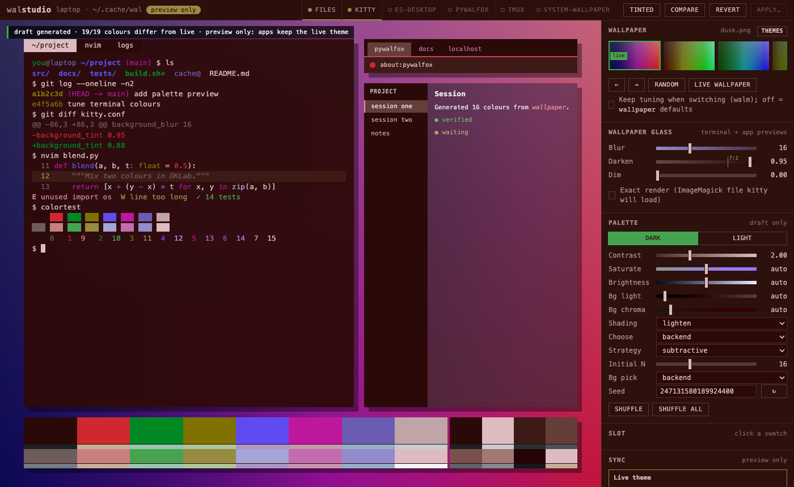
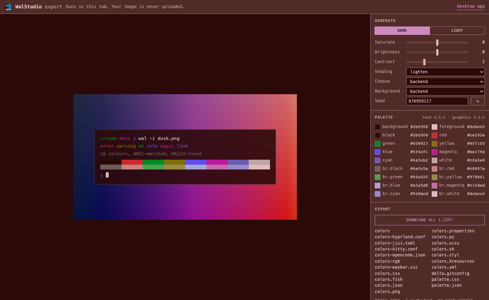

# Palette Studio and WalStudio

Palette Studio is a local web UI for this fork: pick a wallpaper, tune the palette, preview it on a mock desktop (terminal, browser, app), then Apply it to the apps you choose, with a backup for Undo. WalStudio is the same UI as a macOS app.

## Run

    uv run -m pywal.studio                    # http://127.0.0.1:4790/, preview only
    uv run -m pywal.studio --allow-apply      # enable Apply

| Option | Default | Meaning |
|---|---|---|
| `--wallpapers DIR` | `~/wallpapers` | images offered in the strip |
| `--live-dir DIR` | `~/.cache/wal` | the theme files Apply writes (what apps read) |
| `--targets a,b` | all | sync targets this instance may plan or apply; others are refused by the server |
| `--backups DIR` | `~/.cache/pywal-studio/backups` | before-Apply copies (Undo) and applied history |
| `--scratch DIR` | temp | previews and thumbnails; never the live directory |
| `--host`, `--port` | `127.0.0.1`, `4790` | keep loopback: wallpapers and palettes stay private |

Needs Python 3.13+, `uv`, and ImageMagick (`magick`) on `PATH` for palette generation, blur and thumbnails.

## Use

- **Wallpaper strip**: click to generate; ←/→, Random, Live wallpaper (jump to the live theme's image). A coloured band under a thumbnail means the cache already holds a scheme for it.
- **Themes**: built-in and saved themes, and cached schemes, each with an 8-colour band; Save stores the draft as a theme.
- **Palette**: dark/light, contrast, saturation, brightness, background lightness/chroma, shading, choose, strategy, seed, shuffle. Every change updates the draft only; the stage says when it is updating, the result, or why a preview failed.
- **Slot**: click a swatch to pin a colour (hex or OKLCH sliders).
- **Wallpaper glass**: Blur, Darken (terminal background tint toward the palette background; a 7:1 readability floor is marked), Dim (darken the wallpaper itself). Previewed on the terminal and app mocks.
- **Compare**: split the stage against the live theme; hold C to flash it.
- **Sync**: a mode line says where Apply writes (live theme or a private profile). Plan shows every write and command; Apply asks for confirmation, then reports each target.
- **Applied**: every Apply with its palette, targets and per-target result, per wallpaper; Load (as draft), Compare, Restore (through Plan/Apply). History starts with this version.
- **Before-Apply backups**: the live files as they were before each Apply; load one and Apply it to undo.

## Sync targets

| Target | What Apply does | Proof shown | Tested |
|---|---|---|---|
| files | backs up, then writes `colors.json`, `palette.json/css` and every template into the live directory | re-reads `colors.json` | macOS |
| kitty | `kitty @ set-colors` + blurred (and dimmed) wallpaper as background image, every instance | `kitty @ get-colors` | macOS, kitty 0.47 |
| pywalfox | `pywalfox update` | none (no readback): `sent` | macOS |
| tmux | re-sources `~/.config/tmux/tmux.conf` or `~/.tmux.conf` | exit status | macOS |
| Editspace (optional) | nothing; the app follows `colors.json` | its appearance receipt: `loaded`, or `verified` when an open window confirms it | macOS |
| system wallpaper | pywal's wallpaper change | none; off by default | not tested |

Absent apps are shown as unavailable with the reason and are skipped. kitty needs remote control: `allow_remote_control socket-only` and `listen_on unix:/tmp/kitty-{kitty_pid}.sock` in `kitty.conf`, and `background_image ~/.cache/wal/wallpaper.blurred` to show the glass. Other apps that read pywal's templates (nvim, delta, jjui, opencode, waybar, …) pick up the new files on their next reload; Studio does not reload them.

Not supported: detecting or theming arbitrary installed apps; Apply on Linux/Windows is untested.

## WalStudio (macOS app)

    desktop/walstudio/bundle.sh       # builds desktop/walstudio/dist/WalStudio.app (unsigned)

The app runs its own Studio backend on a free loopback port and stops it on quit. File > Choose Wallpapers… picks a folder or an image on your Mac. By default Apply writes a private profile inside the app (your apps keep their theme); the Sync mode line switches to the live theme (`~/.cache/wal`) after a confirmation. Settings: `~/Library/Application Support/WalStudio/config.json` (`pywal`, `wallpapers`, `liveDir`, `targets`). The app is unsigned: right-click > Open the first time.

From a release: clone this fork to `~/pywal` (or set `pywal` in the config), unzip `WalStudio.app` from the release, then right-click > Open. It needs `uv` and ImageMagick as above.

## Browser export

A static page that turns one wallpaper into a scheme and its files, without installing anything. Export only: no Apply, no upload.

    uv run python site/build.py                              # site/dist
    python3 -m http.server 8000 --directory site/dist        # any static host works

- Runs the fork's palette pipeline and exporters in [Pyodide](https://pyodide.org) inside a Web Worker. The image is read into the tab's memory and never sent anywhere; the page loads Pyodide and Pillow from jsDelivr.
- Controls: dark/light, saturate, brightness, contrast, shading, choose, background strategy, seed. Output: `colors.json`, `palette.json/css` and every template, singly or as `wal.zip` (unzip into `~/.cache/wal`).
- Shows the equivalent `wal` command, with the seed.
- Hosting: any static host. Pyodide needs eval and WebAssembly, and Chrome applies the page's policy to the worker and its module imports, so one policy covers both: `default-src 'none'; script-src 'self' https://cdn.jsdelivr.net 'unsafe-eval' 'wasm-unsafe-eval'; worker-src 'self' https://cdn.jsdelivr.net; connect-src 'self' https://cdn.jsdelivr.net; style-src 'self'; img-src 'self' blob:; base-uri 'none'; form-action 'none'; frame-ancestors 'none'`. Requests go only to the site and cdn.jsdelivr.net.
- Approximation: the desktop uses `modern_colorthief` (Rust) and ImageMagick; the browser uses the pure-Python colorthief port and Pillow. Across 46 test wallpapers a median 84% of slots matched the desktop within 12/255 per channel; small quantizer differences can move a colour to another slot.

## Files and privacy

Studio reads only the wallpaper folder, the live wallpaper and its own scratch; it binds to loopback, makes no network requests and sends no images anywhere. `palette.json` carries no file paths; `colors.json` and the applied history do (they stay on your machine).
